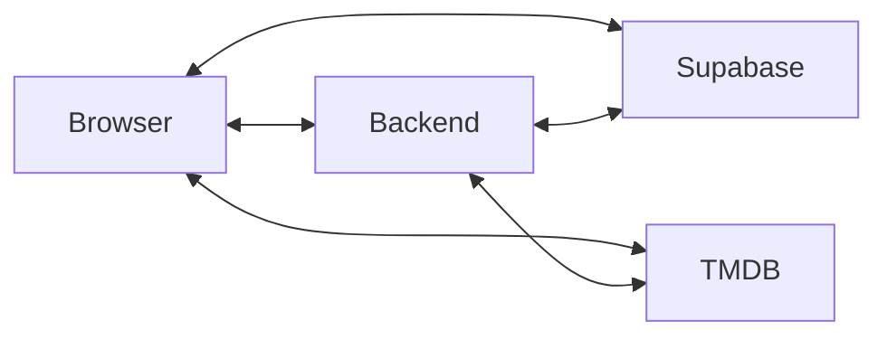

# Architecture

## Requests and data

The browser requests public movie, TV and people data directly from TMDB. Supabase handles email OTP sign-in and session persistence. User-owned collections and notes go through the Express backend under `/api`, with the Supabase session token in `Authorization: Bearer <token>`.

For every collection request, backend authentication calls Supabase `auth.getUser()` to verify the token. Queries use a Supabase client carrying that token, so database row-level security applies to the caller. The service key is reserved for media sync.

## Frontend

`frontend/src/app/` contains thin Expo Router routes. Screens, services, hooks and plain-type models belong in `features/auth`, `features/movies`, `features/people` or `features/collections`. Shared UI lives in `components/`; reusable hooks and infrastructure live in `hooks/` and `lib/`. Navigation helpers live in `navigation/`, and visual tokens in `theme/`.

TanStack Query hooks own server data, caching and invalidation. Services return data and throw `ApiError` on failure. Models are plain TypeScript types. Components use theme tokens for consistent styling.

`AuthProvider` follows Supabase session changes. `withAuth` protects collection and profile screens, waiting for session loading before redirecting guests to login. The `return_to` allow-list accepts home, movie and protected routes; untrusted destinations resolve to home.

## Static rendering and hydration

Expo exports route HTML which Express serves from `backend/public`. Dynamic movie, people and collection routes use their matching exported template. Server HTML must match the first client render; queries stay paused until hydration finishes, and browser tests check direct loads in Chromium and Firefox.

The expo-font patch reads CSS font properties through `getPropertyValue` so exported fonts are recognized consistently in Firefox during hydration.

## Backend

Requests follow routes → validators → controllers → repositories. Middleware verifies authentication; validators check request bodies; controllers apply application behavior; repositories contain Supabase queries. Shared response helpers return `{ success, message, data }` on success and `{ success: false, message }` on failure, with `debugMessage` only in development. The health checks instead return `{ "status": "ok" }`; `/api/health/db` also runs a small database query and returns 503 with `{ "status": "error" }` when it fails.

`FAVMOV_NODE_ENV` selects `dev_` or `prod_` table and view prefixes. Any other value fails data requests. The expected database objects and required configuration are listed in the [README](../README.md#getting-started); the schema and policies must be provisioned separately.

See the [API reference](api.md) for endpoint contracts.

## SEO

Movie and TV page requests use the backend TMDB token to fill title, description and social tags. Lookups are cached for one hour, missing titles for five minutes, with a 1,000-entry limit and a 30-second cooldown after failures. A missing title returns 404; a TMDB failure serves the page with default tags.

## Media sync

With both backend sync keys configured, the first request of each UTC day starts one background run; failures retry on the first request at least an hour later. Sync compares stored movies and TV shows with TMDB and updates changed metadata, continuing after individual failures and skipping titles absent from TMDB. The manual `pnpm --dir backend sync` command exits nonzero if any rows fail.
